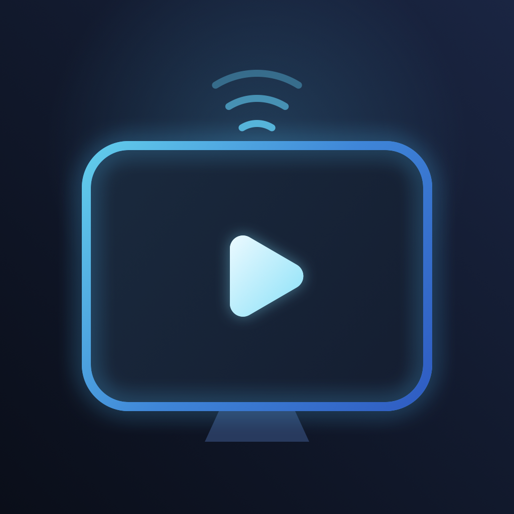

  

<h1 align="center">BruTV</h1>

A native player for the live TV, movies, and series sources you bring.

<a href="https://bvolpato.github.io/brutv/">Project site</a> · <a href="https://github.com/bvolpato/brutv">Source code</a>

> [!IMPORTANT]
> **BruTV is a player only. It does not provide, host, share, or sell channels, movies, playlists, or subscriptions. Bring a source you are authorized to use.**

BruTV connects to a source configured on your device. It does not operate a hosted streaming or proxy service, or distribute media content. Some platforms use a relay that runs locally on your device. Sign-in QR codes and Android TV pairing can transfer source credentials between your devices when you choose.

## What you can do

- Add an Xtream Codes account or an M3U playlist.
- Browse live channels, groups, search results, favorites, and recent items.
- Browse movies, series, and episodes when your source provides them.
- Open supported sign-in QR codes and `brutv://login` links.
- Use Picture in Picture on supported Apple devices and remote navigation on Apple TV and Android TV.
- Pause and rewind some supported HLS live streams with a temporary on-device buffer. This is not a recording library, and stream formats and device behavior vary.

The app does not include accounts, channels, playlists, movies, or subscriptions.

## Platforms

| Platform | Status in this repository |
| --- | --- |
| iPhone and iPad | Native SwiftUI app source |
| Mac | Mac Catalyst app source |
| Apple TV | tvOS app source |
| Android phones and tablets | Native Kotlin app source |
| Android TV, Google TV, and Android-based Fire TV | Android app adapts its interface for TV and remote control |
| Vega OS | Experimental source starter. Native packaging and device validation are still needed. |
| PS5 | Experimental homebrew port. Physical-console validation is unconfirmed. |

Source availability does not mean a store release, signed download, or every device configuration is available. See the platform guides for build and validation details.

## Get started

1. Try the [Apple beta through TestFlight](https://testflight.apple.com/join/6twEYnQy) or install the [Android APK](https://brunovolpato.com/brutv/downloads/BruTV-android-1.0.1-6.apk).
2. Add an M3U playlist or Xtream Codes source you have permission to access.
3. Browse the channels, movies, or series available from your source.

For source builds, see the [Apple](mobile/ios/RELEASE.md), [Android](mobile/android/README.md), [Vega OS](mobile/vega/README.md), and [PS5](mobile/ps5/README.md) guides.

## Privacy and sign-in

BruTV sends playback and catalog requests from your device to the source you configure. It does not operate a hosted streaming or proxy service. Some platforms keep settings, source details, or temporary playback data on your device. See the [privacy policy](PRIVACY.md).

The Apple apps keep bounded playback-health summaries locally. You can clear or share them in Settings; BruTV does not upload them automatically or include an analytics SDK. The summaries record startup, buffering and recovery events, and do not detect frozen video frames or general app hangs.

A `brutv://login` link or sign-in QR code can include source credentials in the link. Only share it with a device or person you trust. The [join helper](https://bvolpato.github.io/brutv/join.html) reads credentials from the URL fragment (the part after `#`) so the page host does not receive them in the page request. Do not share a credential-bearing page URL publicly.

## Development

- Run the portable Apple core checks with `./test.sh --core`.
- Run Android checks with `./mobile/android/test.sh` and the Android SDK installed.
- Apple simulator tests require macOS and Xcode: `./test.sh`.
- Build and test Apple releases with Xcode 27.2 and its SDKs. iPhone Duo UI checks use the compatible iOS 27.1 simulator runtime; physical fold transitions and playback remain device checks.
- See each platform guide for its build environment and additional checks.

CI selects checks from the changed files. Documentation changes skip app builds, while site changes run the join-page checks. Apple changes run unit tests, a short iPhone UI smoke suite, and tvOS/Catalyst builds. Test diagnostics are retained only on failure.

Before releasing, run the full platform and Apple device suites with `gh workflow run ci.yml --ref main -f scope=full`. Pushing a `v*` tag also selects full validation. Manual runs can select an individual platform instead.

## License

BruTV's original code is licensed under the [MIT License](LICENSE), except for the standalone [PS5 port](mobile/ps5/LICENSE), which remains GPL-3.0-or-later. Third-party code and assets keep their original licenses and notices.
